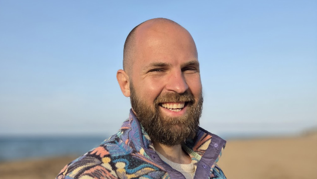

<figure>

<figcaption>This is me during a family holiday in Spain, in 2026.</figcaption>
</figure>

I build simple, privacy-friendly WordPress products used by millions of websites. I’m Danny van Kooten, an independent software developer from The Netherlands.

In 2013, while living in Vietnam, I was hospitalized with acute appendicitis. During recovery, I built the [Mailchimp for WordPress plugin](https://www.mc4wp.com/) from my hospital bed. Within six months, users had downloaded it more than 100,000 times. Today, it runs on more than two million WordPress sites.

Several other plugins followed over the next few years while I was living in Chiang Mai. In 2017, my first daughter was born and I moved back to Europe to settle down.

I helped bootstrap an early version of Fathom Analytics and brought in its first paying customers. I stepped away in 2019, shortly after my second daughter was born. Later that year I released [Koko Analytics](https://www.kokoanalytics.com/), a privacy-friendly analytics plugin built specifically for WordPress.

These days, I spend most of my time improving existing products, keeping them fast, and making them easier to use.

## Principles

I like software that is simple, efficient, unobtrusive and maintained for the long term. I prefer tools that do a small number of things well and keep working without constant attention.

Most of my work sits in the WordPress ecosystem, where small improvements can reach millions of sites.

## Work

I run [ibericode](https://www.ibericode.com/), a small and fully remote company building premium WordPress plugins. Our main products right now are Mailchimp for WordPress and Koko Analytics.

Much of my work is open-source and published on [GitHub](https://www.github.com/dannyvankooten).

## Life

Outside work, I walk my dog Koko, bake Neapolitan pizza, ride bikes, lift weights, and climb rocks.

I also enjoy endurance challenges, mostly because of the mental aspect: long bike rides, triathlons, and mountain events like La Marmotte in the French Alps.
