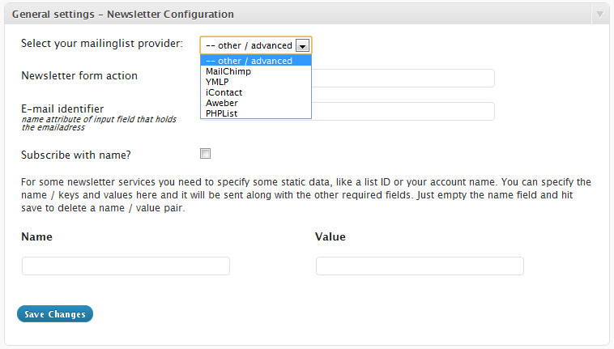
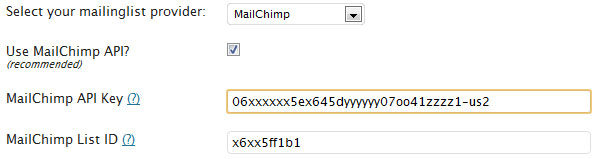
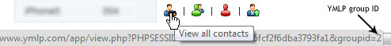
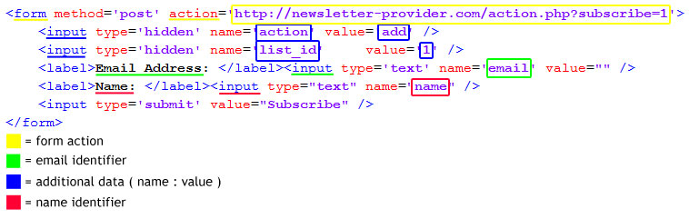

> This article is very old and not relevant anymore. Use the [Mailchimp for WordPress plugin](https://www.mc4wp.com/) instead.

> #### Table of contents
> 
> 1.  [Downloading & Installing](#downloading-installing)
> 2.  [Configuring Newsletter Sign-Up](#configuring)
> 3.  [Mailchimp](#using-the-mailchimp-api)
> 4.  [YMLP](#using-the-ymlp-api)
> 5.  [Other newsletter services](#other-services-custom-settings)
> 6.  [Testing](#testing)

After Newsletter Sign-Up has been downloaded well over 50.000 times I have gotten quite some questions on how to properly configure the plugin. No wonder, the plugin is not that easy to configure for the less tech savvy WordPress users.

With this guide I am trying to make things a little easier.

#### Downloading & Installing

You can download and install the Newsletter Sign-Up plugin just like you would install any other WordPress plugin.

1.  Search for **Newsletter Sign-Up** in the plugin repository.
2.  Install right away or download the ZIP file and upload the contents of it to your `/wp-content/plugins/` folder.

Not familiar with installing WordPress plugins? The [WordPress codex has a helpful article on installing plugins](https://wordpress.org/documentation/article/manage-plugins/#Installing_Plugins) that might help.

### Configuring

Clicking the _settings_ link will take you to the settings page for the plugin. The most important configuration settings are located on the **general settings** screen. These settings are essential if you want to get Newsletter Sign-Up to work with your newsletter service.

If your newsletter service is included in the dropdown box, selecting it will prefill some fields for you. You could however just leave the select box at _other / advanced_ and provide all the necessary values yourself.

If you’re using Mailchimp or YMLP then you have the option to use their API, which I recommend. Let’s start with those two.

#### Using the Mailchimp API

1.  Selecting Mailchimp from the _mailinglist provider_ dropdown and tick the checkbox that says _Use Mailchimp API?_
2.  Fill in your API key and Mailchimp list ID. If you’re not sure where to find these, click the `?`\-link.

#### Using the YMLP API

1.  Select _YMLP_ from the newsletter provider dropdown and tick the checkbox that says _Use YMLP API?_.
2.  Fill in your YMLP username and API key, which you can find by clicking the `?`\-link.
3.  To find your YMLP group ID, go to your YMLP dashboard and take a look at the “Your Contacts” screen. Hover the icon for the list you want to use and take note of the URL which includes your `groupid`.

#### Other services & custom settings

If you’re using iContact, Aweber, ConstantContact or GetResponse then this is your section. Configuring Newsletter Sign-Up for those services is a little harder but definitely not impossible.

1.  Get your form embed code Head over to your newsletter service and look for a sign-up form to embed. We need this piece of HTML to extract the required configuration values.
    
2.  Go to **Newsletter Sign-Up > Config Extractor** and paste your form embed code.
    
3.  The plugin will automatically try to extract the correct configuration values for you. In some cases this will fail though. No worries, you can still manually extract the various settings.
    

**Form action**\
The form action is the `action` attribute of the form element. This tells Newsletter Sign-Up where to send the subscription request to.

**Email Identifier**\
The email identifier is the `name` attribute of the `input` field that holds the email address.

**Name Identifier**\
The name identifier is the `name` attribute of the `input` field that holds the name.

**Additional Data**\
Additional data can be anything in key / value pairs. Provide any other fields you find in the embed form as additional data, using the value of the `name` attribute as the key.

I made the image above a long time ago, I really hope it makes any sense at all…

### Testing

Testing to see if you properly configured Newsletter Sign-Up is pretty straightforward.

Include the form on any of your page using the `[nsu_form]` shortcode and submit it to see if it works.

Make sure to use an email address that is not already on your list as most newsletter services will silently ignore those. Also, have at least a few minutes of patience and make sure to check your SPAM folder for an email confirmation.

#### Still a bit lost? Try this.

-   Configuration guide by UnwireMe
-   Drop me a line through the support forums for Newsletter Sign-Up, include your sign-up form and me or someone else will extract the correct values as soon as we find a spare minute!
