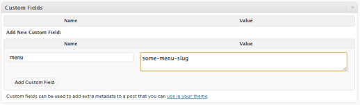

Since WordPress 3.0 you can use custom menus in your themes, which is great because of how easy to use they are for you or (if you’re a developer) for your cliënts. You can register theme locations where menus can be hooked to, which is particularly useful for site-wide menus like a header menu. But what if you need to hook a menu to a certain page/post or maybe even multiple posts? I’ve looked around a bit and found no plugin yet that took care of this, while the coding part would be pretty simple. That’s why I’m going to walk you through the necessary steps to implement this in your theme. But first, let’s talk a bit about the different functions that came with custom menus and which we are going to need.

[`wp_nav_menu()`](https://developer.wordpress.org/reference/functions/wp_nav_menu/) – This is the function that calls and echoes the custom menu. You can specify many parameters but the ones we care about at the moment are ‘theme\_location’ and ‘menu’. ‘theme\_location’ calls the menu that is hooked to the given location, ‘menu’ calls the menu by ID, slug or name.

`is_nav_menu()` – This function checks if a given menu exists, again accepts (matching in order) ID, slug or name.

With these two functions we can check if a given menu exists and if it does call it, if not we can either do nothing, call a default menu or whatever you want to do when there’s no custom menu hooked to the current page.

## Hooking a custom menu to a page or post

Like always, there are multiple ways to do this. We can look for `$_SERVER['REQUEST_URI']` and use that as our menu name, however this comes with a big downside: we are limited to 1 page per menu. We won’t be creating a dynamic custom menu for EVERY page or post so this is probably not what you want. What we want is to create a one-to-many relationship between a menu and certain pages or posts. What about adding a post\_meta value that holds the menu id or slug, whichever is easiest?

_(**Note:** As of WordPress version 3.1, some screen options on the Post & Page edit Administration Panels are hidden by default. Custom Fields are hidden by default if they have not been used before.)_



By specifying the menu slug as a custom field meta value we can call this from our template files from inside the loop by using [`get_post_meta()`](https://developer.wordpress.org/reference/functions/get_post_meta/). Then we check if a custom menu with that slug exists, just to be sure. If it exists, output the menu using `wp_nav_menu()`. I’m not specifying a lot of parameters here, but of course you can just specify what’s needed inside the parameter array.

```
$menu_slug = get_post_meta( get_the_ID(), 'menu', true );

if( $menu_slug && is_nav_menu( $menu_slug ) ) {
    wp_nav_menu(
        array(
            'menu' => $menu_slug
        )
    );
}
// optionally, use an else-statement output something when no menu exists with the given meta value.
```

So there we have it, we hooked a menu to a post.

Now, if we wanted to make things easier we would get all nav menus with `wp_get_nav_menus()` and add a select box to the edit post screen where users can choose their which menu to show.

In fact, I might create a [WordPress plugin](/wordpress-plugins/) that does just that if it turns out people are actually interesting in such a thing.

**Update (November 2013):** The CE WP-Menu Per Page plugin seems to do just this.\
**Update (November 2016):** The CE WP-Menu Per Page plugin is abandoned.
