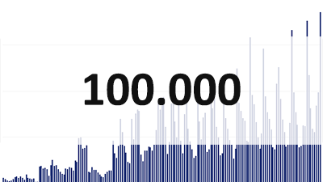
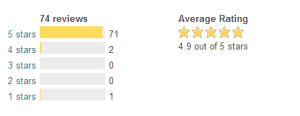

Mailchimp for WordPress just broke through the 100.000 downloads mark. Less than 6 months ago, I wrote the first lines of code for it from a hospital bed in Vietnam.

### It started with “a cute appendicitis”

6 months ago I was in Vietnam and not feeling well. I went to see a (Vietnamese) doctor who ran some tests and then told me I had acute appendicitis, which I repeatedly mistook for “a cute appendicitis” due to his slight accent and me being so, so tired.

A few hours later my appendix was removed in surgery – I have a photo but I will spare you the details.

The next week I was on a lot of painkillers, bored and sleeping the days away in my hospital bed. The room was better than the hostels I had been staying in and I was cared for very well by a team of exceptionally kind nurses. I was actually enjoying my time in the hospital.

### First lines of code

A Dutch friend brought me flowers and my laptop – gold. I couldn’t be more excited, after all I would have plenty of time to work on that idea I had for a new plugin.

I started playing around with the code and a few days later, the first version of [Mailchimp for WordPress](https://www.mc4wp.com/) was available for download from the WordPress.org plugin repository. It didn’t do much besides adding a sign-up checkbox to your registration and comment forms but it was enough to have users provide me with valuable feedback.

From there, I iterated on a weekly basis, continuously improving the plugin, adding new features and fixing bugs. I built a premium version as well, which allowed me to spend more time on this and several other plugins.

### 100.000 plugin downloads!

Today, barely 6 months later the plugin [has been downloaded](https://wordpress.org/plugins/Mailchimp-for-wp/stats/) over **100.000 times**. This makes me so happy. It was well received by the WordPress community and the [plugin reviews](https://wordpress.org/support/view/plugin-reviews/Mailchimp-for-wp) reflect that. I am grateful for each and every one of you that took the time to leave a plugin review.

I learned a ton and really enjoyed every minute I spent on the plugin.

My mind is currently buzzing with ideas so I’ll definitely be focusing on developing more and better plugins in 2014. If you like to stay in touch: [follow me on Twitter](https://twitter.com/dannyvankooten) or subscribe to the newsletter I send out occasionally.

_PS. Starting in February I will be doing my graduation internship at a company most (if not all) of you know, but I’ll talk more about that soon._

## Related reading

-   [Introducing Mailchimp for WordPress](/blog/2013/my-newest-wordpress-plugin-mailchimp-for-wp/)
-   [One million downloads for Mailchimp for WordPress](/blog/2015/one-million-downloads-mailchimp-wordpress/)
-   [Two million downloads for Mailchimp for WordPress](/blog/2015/celebrating-2-million-downloads-for-mc4wp/)
-   [Version 2.0 of Mailchimp for WordPress](/blog/2014/version-2-of-mailchimp-for-wordpress/)
