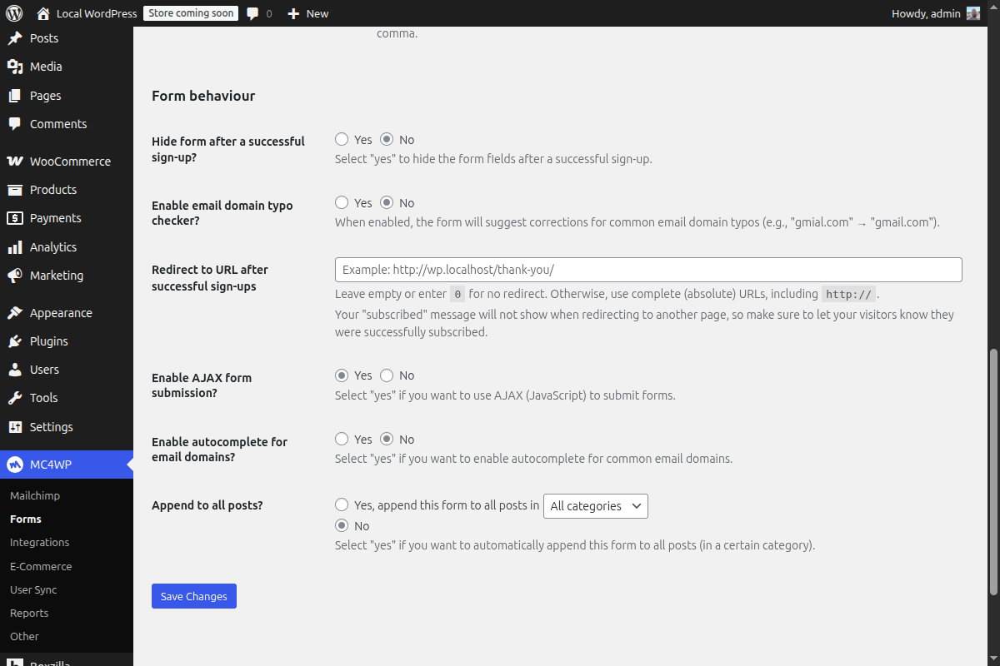

The end of a blog post is a good place to ask readers to join your Mailchimp list. If someone reaches the final paragraph, they have already spent time with your content and are more likely to want future updates.

This article shows how to add a Mailchimp signup form below every WordPress post. The easiest option is built into [Mailchimp for WordPress Premium](https://www.mc4wp.com/), so you can do this without writing or maintaining custom code.

## The no-code option

If you use Mailchimp for WordPress Premium, you can automatically show a form after your posts from the plugin settings. This is the recommended approach for most sites because it keeps the placement separate from your theme code.

That means the form keeps working when you update or change your theme, and you do not have to edit `functions.php` or maintain a custom snippet.

## What you need

-   [Mailchimp for WordPress](https://wordpress.org/plugins/mailchimp-for-wp/)
-   A published Mailchimp signup form
-   Mailchimp for WordPress Premium if you want the built-in, no-code placement option

## No code

Go to the form you want to append to all posts, open the settings tab and locate the “Append to posts” setting.



You can choose to append the form to all posts or only to posts within a specific category.

## Manual code option

If you prefer to add the form with code, you can append it to the post content with WordPress’ `the_content` filter. Add this to a small custom plugin, a site-specific snippets plugin, or your child theme. Avoid editing a parent theme directly, because theme updates can overwrite your changes.

```
/**
 * Add a Mailchimp for WordPress form after single blog posts.
 *
 * @param string $content The post content.
 * @return string
 */
function myprefix_add_mailchimp_form_after_posts( $content ) {
    if ( ! is_singular( 'post' ) || ! in_the_loop() || ! is_main_query() ) {
        return $content;
    }

    if ( ! function_exists( 'mc4wp_get_form' ) ) {
        return $content;
    }

    // Use 0 for the default form, or replace it with a specific form ID.
    $form_id = 0;

    return $content . mc4wp_get_form( $form_id );
}
add_filter( 'the_content', 'myprefix_add_mailchimp_form_after_posts' );
```

If you have more than one form, replace `0` with the ID of the form you want to show after each post.

## Be careful with custom PHP

Only use the code option if you are comfortable adding PHP to your site. A small syntax error can break the page, so test the change on a staging site first if possible.

For most site owners, the built-in Mailchimp for WordPress Premium setting is safer and easier. It gives you the same result without tying the form placement to your theme.
