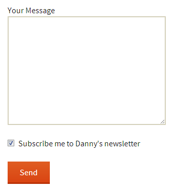

If you use Contact Form 7 on WordPress, you can let people join your Mailchimp list while they submit a form. The current step-by-step instructions live in the Mailchimp for WordPress knowledge base: [subscribe people to Mailchimp from Contact Form 7](https://www.mc4wp.com/kb/subscribe-mailchimp-contact-form-7/).

This article gives the short version. You add one Mailchimp for WordPress checkbox shortcode to your Contact Form 7 form, then Mailchimp for WordPress handles the subscription when the form is submitted.

<figure>



<figcaption>A Mailchimp opt-in checkbox can be added directly to a Contact Form 7 form.</figcaption>
</figure>

## What you need

Before you start, make sure your site has these three things:

-   [Contact Form 7](https://wordpress.org/plugins/contact-form-7/)
-   [Mailchimp for WordPress](https://www.mc4wp.com/)
-   [A Mailchimp account](https://mailchimp.com/)

## Add the checkbox shortcode

Open the Contact Form 7 form you want to edit and add the Mailchimp checkbox shortcode where you want the opt-in field to appear.

```
[mc4wp_checkbox "Yes, send me updates and occasional offers by email."]
```

You can change the label text to match your site. Keep it clear and specific so visitors know what they are signing up for.

When someone submits the form and checks the box, Mailchimp for WordPress reads the email address from the Contact Form 7 submission and sends it to the Mailchimp list you selected in the checkbox settings.

## Send extra fields to Mailchimp

You can also send extra Contact Form 7 fields to Mailchimp merge fields. Prefix the field name with `mc4wp-`, then use the Mailchimp merge tag after the dash.

For example, this field sends a first name value to the Mailchimp `FNAME` merge field:

```
[text* mc4wp-FNAME]
```

The part after `mc4wp-` must match the merge tag in your Mailchimp audience.

## Use clear consent

Use a checkbox label that explains what the visitor will receive. In most cases, leave the checkbox unchecked by default so the visitor actively chooses to subscribe.

## Read the full guide

For the full setup steps, screenshots, and troubleshooting notes, read the canonical guide in the Mailchimp for WordPress knowledge base: [Contact Form 7 Mailchimp integration with Mailchimp for WordPress](https://www.mc4wp.com/kb/subscribe-mailchimp-contact-form-7/).
