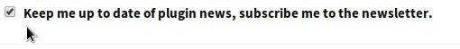
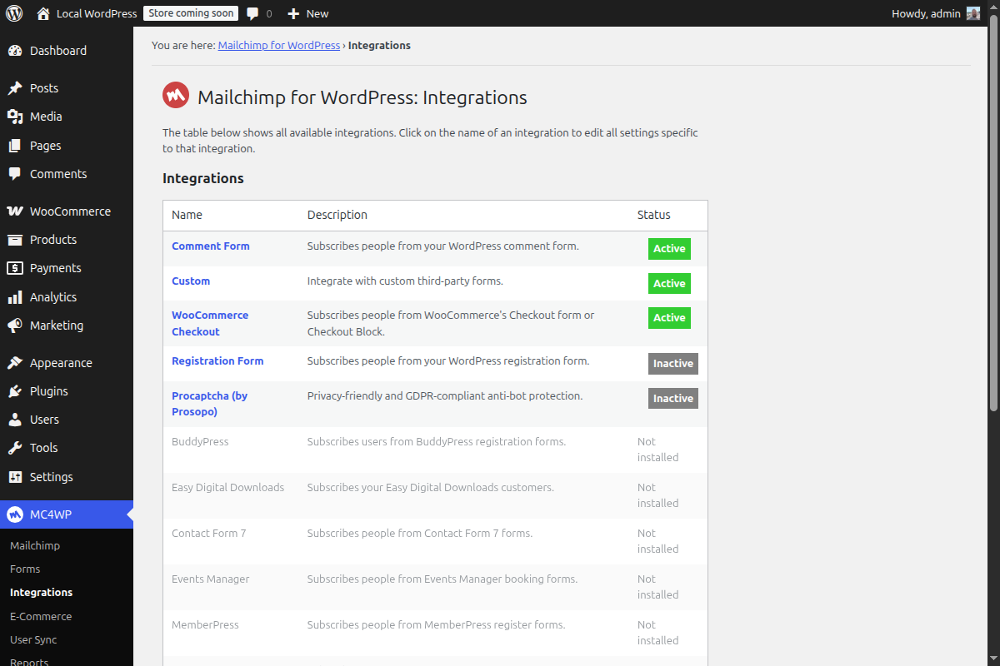
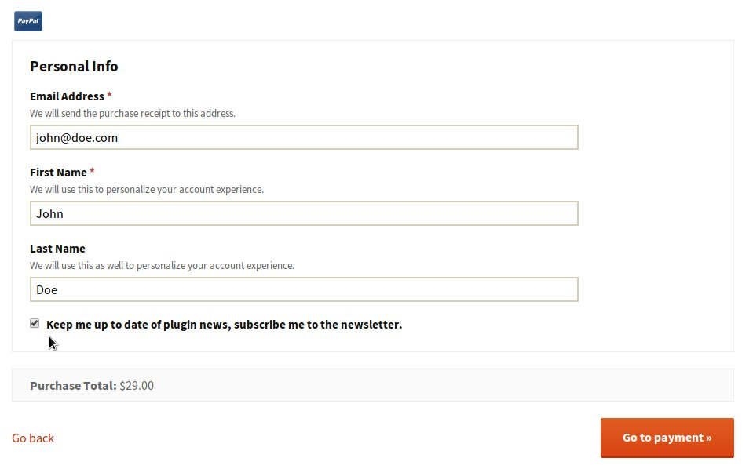

If you run an online store with WordPress, your checkout page is one of the best places to ask customers to join your Mailchimp list. Customers are already entering their name and email address, so a clear opt-in checkbox lets them subscribe without filling out another form.

With [Mailchimp for WordPress](https://www.mc4wp.com/), you can add this checkbox to checkout forms in popular WordPress e-commerce plugins. There is also a detailed knowledge base article that explains how to [add a Mailchimp sign-up checkbox to WooCommerce checkout](https://www.mc4wp.com/kb/subscribe-mailchimp-woocommerce-checkout/).

<figure>

<figcaption>An opt-in checkbox keeps newsletter sign-up simple during checkout.</figcaption>
</figure>

## Why add the checkbox at checkout?

People who buy from you are often the same people who want product updates, new releases, discounts, or helpful follow-up emails. Asking at checkout gives them an easy way to say yes while their interest is high.

The key is to keep the choice simple. Instead of sending customers to a separate newsletter form, add one checkbox with a clear label, such as “Send me product updates and offers by email.”

## Use clear consent

Make sure the checkbox explains what the customer is signing up for. In most cases, it is better to leave the checkbox unchecked by default so the customer actively chooses to subscribe.

A short, specific label works best. For example:

> Yes, send me product updates and occasional offers by email.

## Mailchimp for WordPress integrations

Mailchimp for WordPress can add this checkbox to popular WordPress e-commerce plugins. Once enabled, the plugin detects supported integrations and lets you choose where the opt-in checkbox appears.

At the time of writing, the plugin supports checkout opt-ins for:

-   [WooCommerce](https://woocommerce.com/)
-   [Easy Digital Downloads](https://easydigitaldownloads.com/)

<figure>

<figcaption>A checkout checkbox lets customers join your list without extra form fields.</figcaption>
</figure>

## Other supported plugins

Mailchimp for WordPress also integrates with several non-commerce plugins, including:

-   [Events Manager](https://wp-events-plugin.com/)
-   [Contact Form 7](https://contactform7.com/)
-   [bbPress](https://bbpress.org/)
-   WordPress Multisite
-   [BuddyPress](https://buddypress.org/)

## Want another integration?

If you use a WordPress plugin that is not listed here, let me know. I am always looking for useful integrations that make it easier for site owners to grow their Mailchimp lists.
