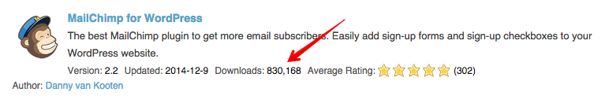
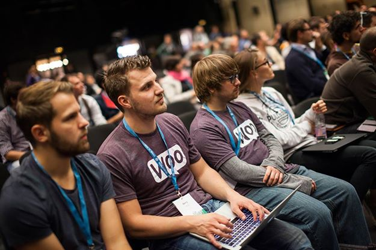

2014 was probably my best year so far. I had more chances than I expected, and I’m grateful for every person, project, and customer that made the year possible.

Here are the main things that happened.

## Mailchimp for WordPress kept growing

At the start of the year, the [Mailchimp for WordPress plugin](https://www.mc4wp.com/) had just over 100,000 free downloads and a few hundred paying customers.

By the end of 2014, the plugin had grown to more than 830,000 free downloads, more than 5,000 paying customers, and 300 positive plugin reviews. Thank you.

## 1.5 million total plugin downloads

My combined WordPress plugin download count grew from 600,000 to just over 1.5 million. That number still feels hard to believe.

Part of that jump came from the [Simple Custom CSS plugin](https://wordpress.org/plugins/simple-custom-css/) by [John Regan](https://johnregan3.wordpress.com/). I contributed a small patch, and John added me as a co-author. That accounts for about 200,000 of the new downloads, so it should be counted with an asterisk.

## WordCamp Europe and seven more countries

I was lucky enough to attend [WordCamp Europe in Bulgaria](https://europe.wordcamp.org/2014/), a meetup for digital nomads in Spain and Morocco, and five other beautiful countries: Germany, England, Italy, Serbia, and Poland.

I also almost made it into a decent photo. I’m the blurry one sitting next to [Barry Kooij](https://barrykooij.com/) and [Mike Jolley](https://mikejolley.com/) from Woo.

## Graduating at Yoast

I got my bachelor’s degree in Computer Science after a six-month internship at [Yoast](https://yoast.com/). During the internship, I mainly worked on building out a re-usable library for managing plugin activations and improving the testability of their WordPress SEO plugin.

## Open-source work

My first open-source project was a small PHP routing library called [AltoRouter](https://github.com/dannyvankooten/altorouter). I built it several years ago, but this year I finally created a simple website for it. That helped the project get close to 300 GitHub stars.

## Reading, learning, and thinking

I learned a lot in 2014: new technologies, web development concepts, ways to run a business, EU VAT rules, how to be a better person, and how to stay sane while traveling or working from home for weeks at a time.

## What’s next?

2015 should be fun. I plan to spend the year on a few things:

-   Releasing a new product, soon to be announced.
-   Adding new features and improvements to Mailchimp for WordPress.
-   Dropping PHP 5.2 support for all of my existing plugins.
-   Hiring someone to help with support for my WordPress plugins.
