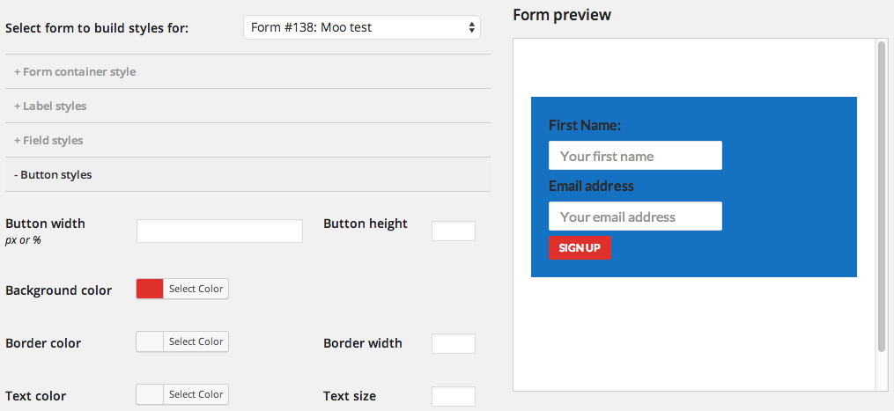
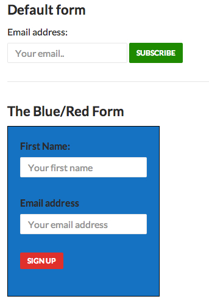

A long-requested feature has just made its way into Mailchimp for WordPress Pro: **the ability to create multiple form themes using the Styles Builder**. This makes it much easier to give individual sign-up forms their own design without writing custom CSS.

### Styling individual sign-up forms

Until now, using the Styles Builder generated a stylesheet that affected all of your sign-up forms. That made it harder to target individual forms. The only option was to add custom CSS rules to the Manual CSS section.

After updating the [Mailchimp for WordPress plugin](https://www.mc4wp.com/) to version 2.4, the Styles Builder will ask which form you want to design styles for.

Selecting a form will load any previous styles you created for that form. When you save your styles, the plugin generates a stylesheet that targets only the selected form. This gives you the ability to use multiple form themes, each with a completely different design.

This works without having to write a single line of CSS.

If you’re using the free version of the plugin and need per-form styling, this is a good reason to upgrade to Mailchimp for WordPress Pro.
