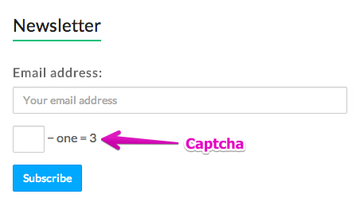
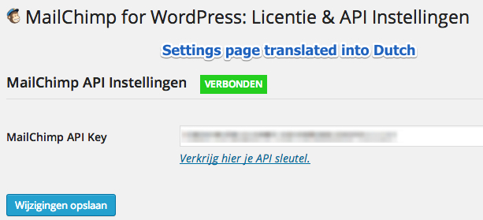

Almost a year after its initial release in June 2013, and nearly 300,000 downloads later, I’ve released version 2.0 of [Mailchimp for WordPress to the WordPress.org plugin repository](https://wordpress.org/plugins/Mailchimp-for-wp/). This update keeps the plugin familiar while adding several useful improvements.

### Support for CAPTCHA fields

The biggest new feature in Mailchimp for WordPress 2.0 is support for mathematical CAPTCHA fields in sign-up forms. The option to include a CAPTCHA field is available when you’re running the Captcha plugin by BestWebSoft.

If you’re using the Captcha plugin, add the `[captcha]` shortcode to your form markup to render the CAPTCHA field. Mailchimp for WordPress will handle validation and show any relevant error messages.

### Translated settings pages

Previously, only the sign-up forms and checkboxes were translatable. In version 2.0, all text on the Mailchimp for WordPress settings pages uses WordPress translation functions, which makes it possible to translate the plugin settings into the language of your WordPress installation.

For now, the plugin includes English, the default language, and Dutch language files. You can [contribute by translating the plugin into your language here](https://translate.wordpress.org/projects/wp-plugins/mailchimp-for-wp/).

### Other changes

-   Stylesheets are no longer combined and served through a `.php` file. They are now served as static and minified CSS, which allows plugins like W3 Total Cache to combine the stylesheets loaded by Mailchimp for WP.
-   You can now use tab indentation in the form markup, which helps keep your markup tidy.
-   The anti-spam honeypot is now added to sign-up checkboxes as well, reducing spam sign-ups even further.
-   Major code improvements, including better object-oriented code and class documentation with PHPDocs.

### Premium plugin

[Mailchimp for WordPress also has a premium version](https://www.mc4wp.com/) with useful improvements over the free version. For example, the Pro version lets you create multiple sign-up forms, where each form can be different and subscribe people to one or more of your Mailchimp lists.

All new features and changes described in this post are also included in the Pro version of the plugin.

### GitHub project

Although it is not directly related to the 2.0 release, the [Mailchimp for WordPress project is now on GitHub](https://github.com/ibericode/mailchimp-for-wordpress). If you would like to follow development of the plugin or contribute code, you can find the project there.

Found a bug? Please [raise an issue on GitHub](https://github.com/ibericode/mailchimp-for-wordpress/issues).

## Updates

**December 2017**\
The Captcha plugin by BestWebSoft was closed and is no longer available. We have replaced it with an alternative solution.

## Related reading

-   [Introducing Mailchimp for WordPress](/blog/2013/my-newest-wordpress-plugin-mailchimp-for-wp/)
-   [100,000 downloads for Mailchimp for WordPress in under 6 months](/blog/2013/100-000-plugin-downloads-6-months-mailchimp-wordpress/)
-   [One million downloads for Mailchimp for WordPress](/blog/2015/one-million-downloads-mailchimp-wordpress/)
-   [Two million downloads for Mailchimp for WordPress](/blog/2015/celebrating-2-million-downloads-for-mc4wp/)
