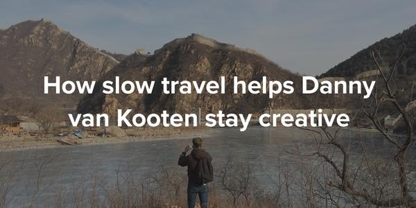

> This article is no longer on the Nomadlist site.

NomadList.com is a website that lists the best places to live and work remotely. I’ve been a huge fan of the site ever since it was created by Pieter Levels during his 12 startups in 12 months.

These last few months, I even based a few of my travel destinations off the available information on the site. On top of that, there’s a pretty active Slack group where nomads can reach out and get together.

A few weeks ago, Pieter reached out to me to ask if I was interested in doing an interview for the NomadList blog. The site (and the accompanying blog) is a huge inspiration for me, so I happily agreed.

In the interview, I talk a bit about my travel style and how traveling helps me stay creative.

At the end of the interview, things get a little personal and I even get to answer the dreaded _“do you think about settling down?”_ question. Uh oh..

Anyway, hope you enjoy reading about my humble adventures!
