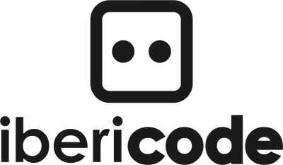

For the last 5 years, I’ve been doing business under my somewhat boring personal name. The official name of my company was just “Danny van Kooten”.

For me, this made perfect sense as I was on my own, working for clients and [selling some of my WordPress plugins](/wordpress-plugins/).

It did cause some confusion every now and then though. Also, I’ve been getting more and more help handling the ever increasing workload and since a few months, I’m working with two wonderful people on a daily basis.

As the team grew by a few hands, we figured we needed a _real_ company name. We thought about a name long and hard and finally settled for **ibericode**.

The name ibericode is a wordplay on **iberico** and **code**, because of the love the team shares for delicious food (Spanish ham, oh boy..) and clean, well-written code.

As developing & supporting software can be perceived as boring, we needed someone cute and fun on the team. That’s where **Rico** comes in, our cute little helper mascot.

You can read all about our new brand on the ibericode blog: [introducing ibericode](https://www.ibericode.com/2015/welcome-to-ibericode/).

I’m very much looking forward to continue our amazing growth under this new name. Hope you like it as much as I do!

_@ibericode was on Twitter. Please follow us if you would like to stay updated of our work & some related ramblings._
