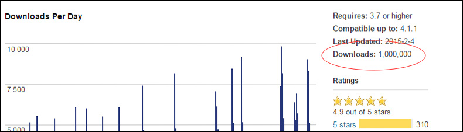

Mailchimp for WordPress reached one million downloads on WordPress.org last Friday. I released the first version less than two years earlier, so seeing it reach that number so quickly felt huge.

A little over a year before this, [the plugin was still at 100,000 downloads](/blog/2013/100-000-plugin-downloads-6-months-mailchimp-wordpress/). At exactly midnight UTC last Friday, someone downloaded it for the millionth time. Someone caught the counter at the right moment and sent me this screenshot.

## More than 12,000 downloads in one day

On that same Friday, the plugin was downloaded more than 12,000 times in 24 hours. Most of those downloads were probably people updating to the latest version, but it was still a number I had looked forward to seeing.

## A top 20 WordPress plugin

Mailchimp for WordPress also appeared in the [Most Popular plugins list on WordPress.org](https://wordpress.org/plugins/). At the time of writing, it was listed at number 17.

## More numbers

We shared more details on the [Mailchimp for WordPress blog](https://www.mc4wp.com/blog/one-million-downloads/), including a few extra numbers from the plugin’s growth.

I’m grateful to everyone who downloaded the plugin, sent feedback, left a review, or wrote about it. Reaching one million downloads is a big milestone, and it makes me even more motivated to keep improving the plugin.

## Related posts

-   [Introducing Mailchimp for WordPress](/blog/2013/my-newest-wordpress-plugin-mailchimp-for-wp/)
-   [100,000 downloads for Mailchimp for WordPress in under 6 months](/blog/2013/100-000-plugin-downloads-6-months-mailchimp-wordpress/)
-   [Two million downloads for Mailchimp for WordPress](/blog/2015/celebrating-2-million-downloads-for-mc4wp/)
-   [Version 2.0 of Mailchimp for WordPress](/blog/2014/version-2-of-mailchimp-for-wordpress/)
