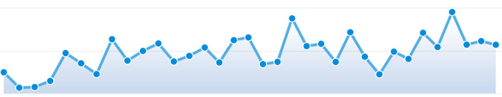
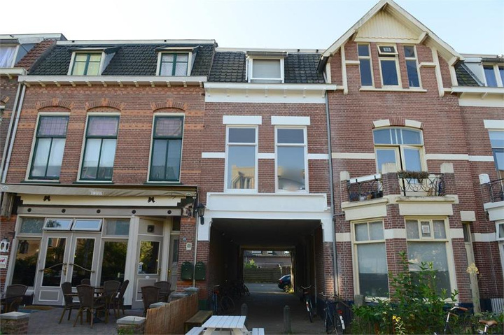
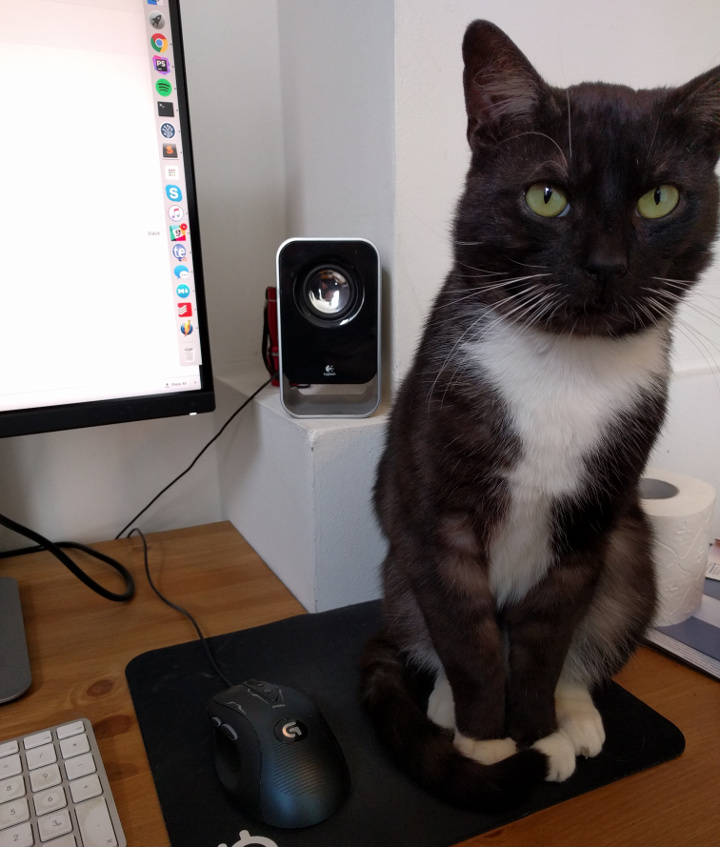
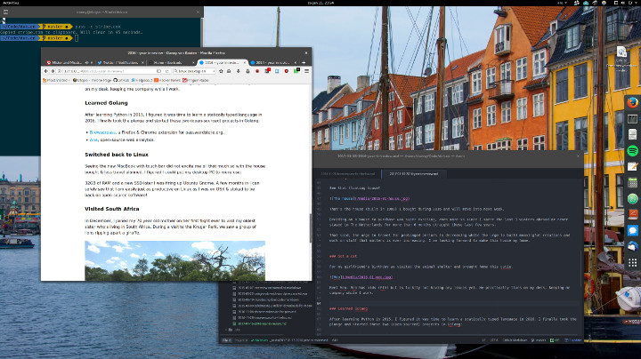
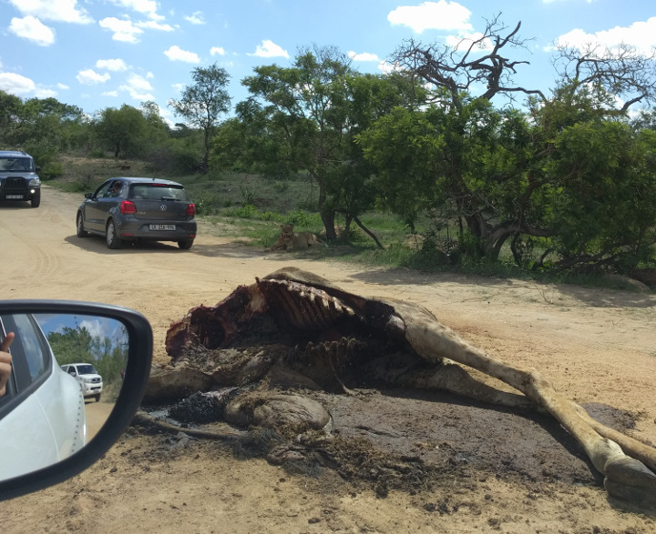

We are already two weeks into 2017, but rereading [my 2014 year in review](/blog/2014/2014-year-in-review/) reminded me how useful these posts are, even if only for myself.

I skipped the review for 2015, so here are the main things that happened in 2016.

## Visited the USA

In May, I spent a short week in New York. I met up with [Chris](https://twitter.com/ChrisVanPatten) and [Vova](https://twitter.com/vovafeldman), enjoyed every minute of the city, and learned that I love New York.

I especially liked Island Burgers & Shakes. I ate there two nights in a row and ordered the same Napalm burger both times.

New York was a stop on my way to [MicroConf](https://www.microconf.com/), a conference in Las Vegas for bootstrapped software companies.

MicroConf was great because I got to meet so many like-minded founders. Many of them were optimizing for lifestyle first, not only for more profit.

## Relaunched Boxzilla

Our Scroll Triggered Boxes plugin for WordPress was having trouble sustaining itself through its paid plan.

MicroConf convinced me that we needed a recurring business model. We rebranded the plugin to [Boxzilla](https://boxzillaplugin.com/) and introduced monthly and yearly subscriptions at the same time.

Seven months later, the benefits of a subscription model are clear. Boxzilla is growing steadily, and I am fairly sure we will break even in the next few months.

## 5 million downloads for Mailchimp for WordPress

Mailchimp revamped its API in 2016, so [we rewrote most of the API client in Mailchimp for WordPress](https://www.mc4wp.com/blog/update-mailchimp-wordpress-4-0/). After that, we worked hard to move users to the new version before Mailchimp shut down its older API endpoints.

That work helped us pass **5 million plugin downloads** across more than **700,000 active websites**.

I am proud that our three-person team can pull this off together.

## Bought a house

See the floating house in the middle?

That is the house I bought last year. It was built in 1908, and I will move into it next week.

Buying a house felt exciting, especially after spending the last three winters abroad and rarely staying in the Netherlands for more than six months at a time.

That said, my urge to travel for long stretches is decreasing. My urge to build meaningful relationships and work on things that matter is growing. I am looking forward to making this house my home.

## Got a cat

For my girlfriend’s birthday, we visited the animal shelter and brought home a cat. Meet Meo.

Meo was found roaming the streets and has FIV, but luckily he is not having any issues yet. He loves to snuggle and practically lives on my desk, keeping me company while I work.

## Learned Go

After learning Python in 2015, I wanted to learn a statically typed programming language next. I chose Go and started two open-source projects:

-   [Browserpass](https://github.com/dannyvankooten/browserpass), a Firefox and Chrome extension for [passwordstore.org](https://www.passwordstore.org/).
-   [Ana](https://github.com/dannyvankooten/ana), open-source web analytics (update 2018: [Ana became Fathom Analytics](/blog/2018/reviving-ana-as-fathom/)).

## Switched back to Linux

The new MacBook with Touch Bar did not excite me much. Since I had bought a house and expected to travel less, I figured I could put my desktop PC to better use.

After adding 32 GB of RAM and a new SSD, I installed Ubuntu Gnome.

A few months later, I can safely say that I am just as productive as I was on macOS. It feels good to be back on open-source software.

## Visited South Africa

In December, I joined my 69-year-old mother on her first flight ever to visit my oldest sister, who lives in South Africa. During a visit to Kruger National Park, we saw a group of lions tearing apart a giraffe.

## Lost 10 kilograms

Looking back, I was slowly gaining weight. I started counting calories to see where I was going wrong, then made lasting changes to my diet. Over the next eight months, I lost 10 kilograms.

I also picked up running and hope to run a full marathon in 2017.

## TL;DR

I started 2016 in Thailand, New York, and Las Vegas, living wild and free. Just kidding, mom.

I ended 2016 with a house of my own and a cat.
