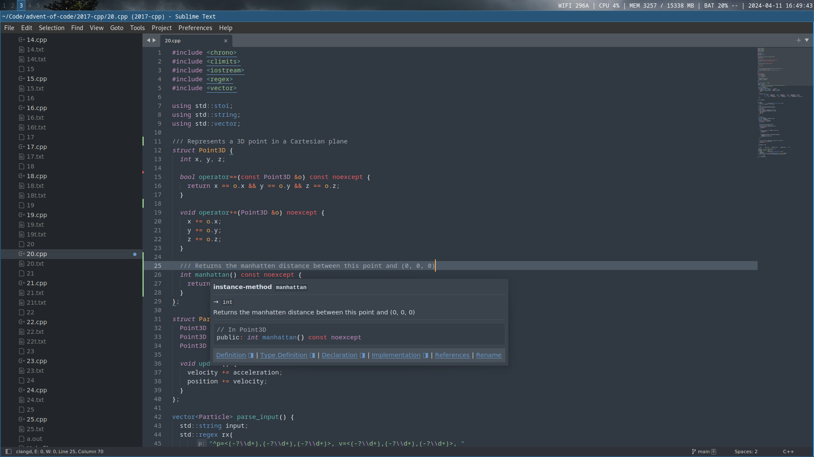
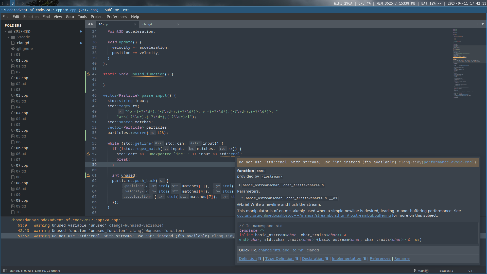

I’ve been doing a lot of C and C++ programming lately. After trying a range of editors and related tooling, I have settled on a setup that is fast, reliable, and powerful.

This post walks through that C++ development setup: Sublime Text 4 with clangd, compiler flags, clang-tidy, clang-format, and perf.

## Editor: Sublime Text

The two most popular options right now are probably VSCode and CLion, yet I found neither of them performant or reliable enough for my taste. Instead, I use [Sublime Text 4](https://www.sublimetext.com/) in combination with [its Language Server Protocol implementation](https://lsp.sublimetext.io/) and [Clangd](https://github.com/sublimelsp/LSP-clangd).



Why Sublime?

-   It’s an order of magnitude faster than both CLion and VSCode.
-   It doesn’t suffer from random crashes on large projects.
-   It’s easy to configure by modifying JSON config files.
-   It works without hours of configuration. Install **LSP** and **LSP-Clangd** through Package Control and you have a powerful editor ready to go.
-   It’s much more resource efficient than the alternatives. I can have a large C++ project open while it consumes less than 600 MB of RAM and the CPU sits idle.

The main drawback is that it’s not open source. Still, I like how a small team from Australia can build a small but profitable business around a code editor.

The [community for plugins](https://packagecontrol.io/) is not as vibrant or active as it once was, but everything I need is there.

## Configuring Clangd

Clangd works with Sublime Text through LSP-clangd out of the box, but a few settings are worth configuring.

First, enable background indexing explicitly.

1.  Go to **Preferences > Package Settings > LSP > Servers > clangd**.
2.  Ensure `initializationOptions["clangd"]["background-index"]` is set to `true`:

```
{
   "initializationOptions":{
      "clangd.background-index":true
   }
}
```

To let Clangd know how to build your project, you can use several methods:

-   A `.clangd` YAML file in your project root containing a `CompileFlags` key. `CompileFlags: Add: [ -std=c++20, -Wall, -Wextra, -Wconversion ]`
-   A `compile_flags.txt` file containing one flag per line. `-std=c++20 -Wall -Wextra -Wconversion`
-   A `compile_commands.json` file. You can have this file generated by CMake by setting the `CMAKE_EXPORT_COMPILE_COMMANDS` environment variable.

## Compiler flags

My workstation runs [Debian](https://www.debian.org/), so I tend to compile the C and C++ projects I work on using whatever version of [GCC](https://gcc.gnu.org/) and [Clang](https://clang.llvm.org/) is in the official package repositories.

Currently, this means GCC 12 and Clang 14, both of which have near-complete support for `-std=c++20` [^1](https://clang.llvm.org/cxx_status.html).

When a newer compiler is needed, there’s always [building GCC from source](https://gcc.gnu.org/wiki/InstallingGCC) or [LLVM’s APT repositories](https://apt.llvm.org/).

Both GCC and Clang are conservative with warnings, so it is worth enabling some of them explicitly. The group of warnings from `-Wall` and `-Wextra` is what I always enable as a baseline [^3](https://clang.llvm.org/docs/DiagnosticsReference.html#w-warnings).

For compilation profiles, I tend to use three:

### Development

Development mode mostly cares about fast compilation times. The `LDFLAGS` environment value instructs the compiler to use [mold](https://github.com/rui314/mold) for the linking stage, which is usually an order of magnitude faster than ld.

```
CFLAGS="-std=c11 -Wall -Wextra -Wvla -Wformat -Wformat=2 -Wconversion -Wdouble-promotion -g"
CXXFLAGS="-std=c++20 -Wall -Wextra -Wconversion -g"
LDFLAGS="-fuse-ld=mold"
```

### Debug

In debug mode, we want debug symbols, stack traces, and runtime checks from both Address Sanitizer and Undefined Behavior Sanitizer.

```
CFLAGS="-g -fsanitize=address,undefined -fno-omit-frame-pointer"
CXXFLAGS="-g -fsanitize=address,undefined -D_GLIBCXX_ASSERTIONS -fno-omit-frame-pointer"
ASAN_OPTIONS="strict_string_checks=1:strict_memcmp=1:quarantine_size_mb=512:detect_stack_use_after_return=1:check_initialization_order=1"
UBSAN_OPTIONS="print_stacktrace=1"
```

`-D_GLIBCXX_ASSERTIONS` adds runtime bound checks for C++ containers from the STL. There is also `-D_FORTIFY_SOURCE=2`, which adds runtime buffer overflow detection for a collection of functions from glibc, but it requires an optimization level of 1 or higher (`-O1`).

`ASAN_OPTIONS` is used to [configure Address Sanitizer](https://github.com/google/sanitizers/wiki/AddressSanitizerFlags) so it can use more memory for detecting use-after-free errors and perform some stricter checks that are disabled by default.

`UBSAN_OPTIONS` is used alongside `-fno-omit-frame-pointer` to [configure Undefined Behavior Sanitizer](https://clang.llvm.org/docs/UndefinedBehaviorSanitizer.html) to print a symbolized stack trace for each error report.

### Release

In release mode, we want the compiler to produce the fastest code possible at the cost of longer compilation times.

```
CFLAGS="-O3"
CXXFLAGS="-O3"
```

If you don’t care about portability and want to target your specific CPU, you could add `-march=native` and `-mtune=native`.

## Diagnostics: clang-tidy

Since we use [Clangd](https://clangd.llvm.org/) as our language server, we can instruct it to emit diagnostics beyond compiler warnings through [clang-tidy](https://clang.llvm.org/extra/clang-tidy/).



clang-tidy is disabled by default, but you can enable it by modifying the settings for the LSP-clangd plugin.

1.  Go to **Preferences > Package Settings > LSP > Servers > Clangd**.
2.  Ensure `initializationOptions.clangd["clang-tidy"]` is set to `true`

```
{
   "initializationOptions":{
      "clangd.clang-tidy":true,
      "clangd.background-index":true,
      "clangd.header-insertion":"iwyu",
      "clangd.completion-style":"detailed"
   }
}
```

3.  You can configure clang-tidy by creating a `.clangd` YAML file in your project root. In it, you can add or remove the [clang-tidy checks](https://clang.llvm.org/extra/clang-tidy/checks/list.html) you want. I mostly stick to the ones from `performance-*` and `cppcoreguidelines-*.`

```
Diagnostics: 
    ClangTidy: 
        Add: 
        - performance-* 
        - cppcoreguidelines-* 
        Remove: 
        - cppcoreguidelines-avoid-magic-numbers
```

The LLVM suite also contains a `run-clang-tidy` command, which you can use to run a single check against your source directory:

```
run-clang-tidy -checks='-*,performance-unnecessary-value-param' src/
```

## Formatter: clang-format

We can use [clang-format](https://clang.llvm.org/docs/ClangFormat.html) through Sublime’s LSP-clangd plugin.

Go to **Preferences > Package Settings > LSP > Settings** and ensure `lsp_format_on_save` is set to `true`.

Your code style can be configured through a `.clang-format` YAML file in your project root.

## Profiling: perf

To find performance bottlenecks, I have not come across anything that beats [perf](https://perf.wiki.kernel.org/index.php/Main_Page) together with [flamegraph.pl](https://github.com/brendangregg/FlameGraph).

The author of flamegraph.pl has a useful post with many language-specific tips on how to [create flamegraphs from a perf report](https://www.brendangregg.com/FlameGraphs/cpuflamegraphs.html).
