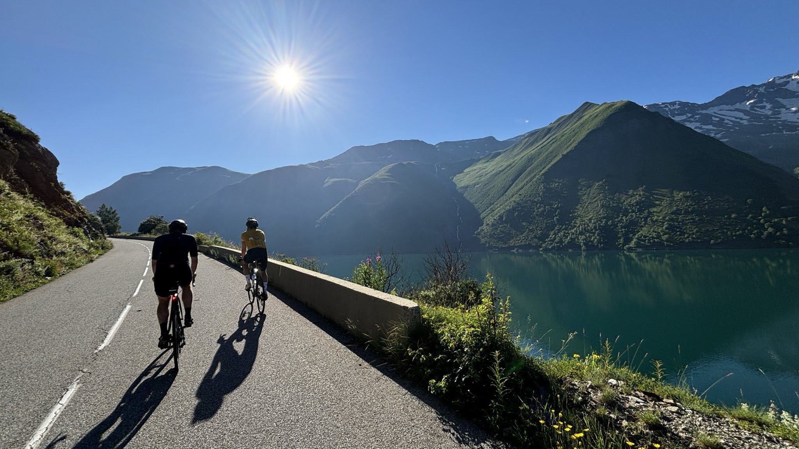
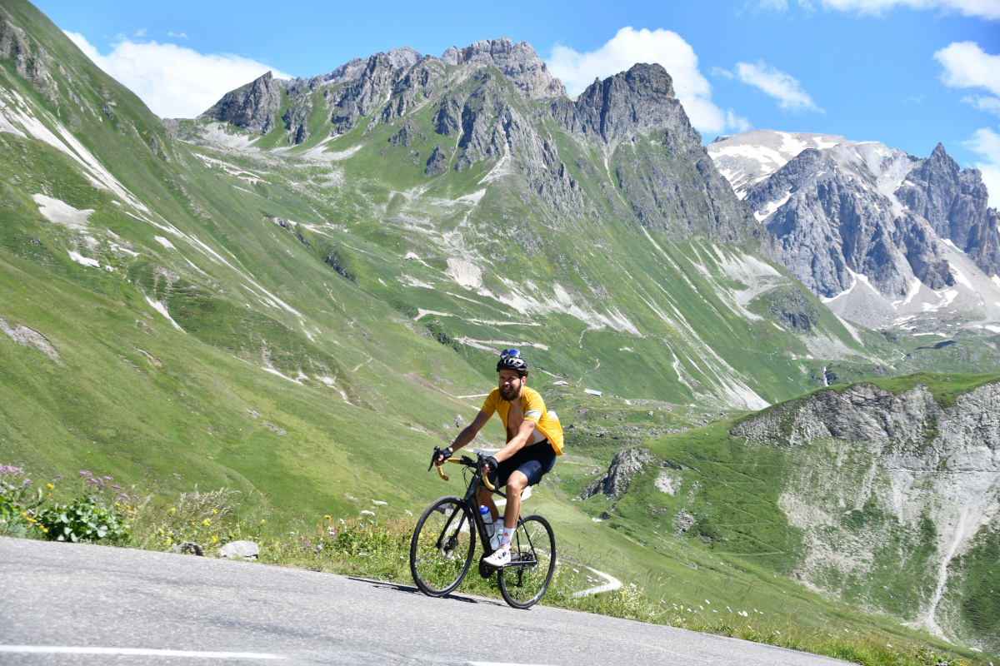
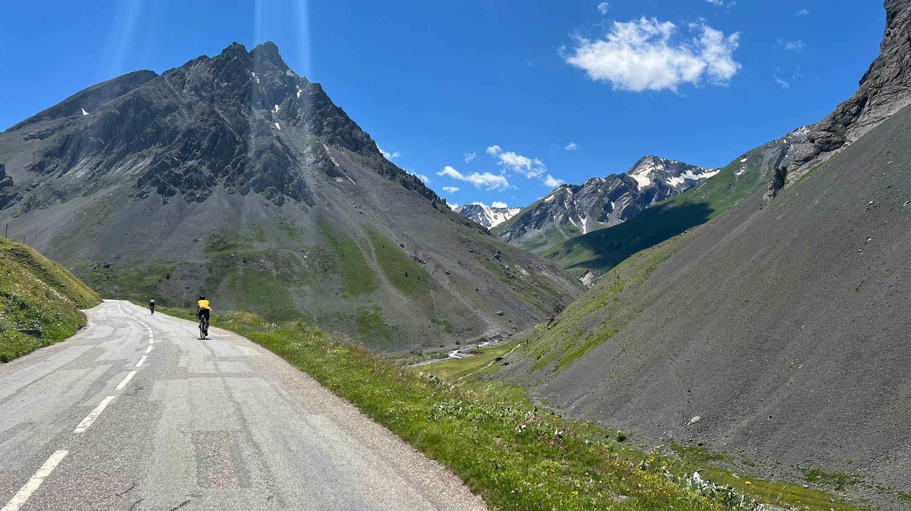

Me and 2 of my older brothers set out with a goal this year to ride Marmotte Granfondo Alpes, a 180km cycling route through the French Alps with about 5500 meters of elevation.

We did just that a couple of weeks ago – and I felt the experience was worth writing about on my blog.

<figure class="gallery">

</figure>

## Training

The training was simple, but took up up a lot of my limited time. I was aiming for at least 6 hours per week on the bike in early spring and closer to 10 hours as the event got closer.

My key sessions each week were a long ride of 3 – 5 hours and a sustained sweet spot ride. In the weeks before the event I did a sweet spot ride of over 2 hours at over 90 percent of FTP.

That particular session type really paid off. My fatigue resistance was more than enough to ride all climbs at high tempo / low threshold and still have something left at the end of the day.

## Nutrition

We figured we needed about 10 hours for the entire route, so we needed to consume at least 600g of carbs on the bike. Preferably more like 900.

I simply took several sachets with 60 grams of plain table sugar in each and used this when refilling our water bottles. Before setting out, I tried to roughly remember the location of various water fountains so that we could keep an eye out for them and not blaze past and then run out of water.

## Col du Glandon

On Glandon, it was all about staying well within our limits, despite feeling good. A fellow Dutch cyclist caught up to us and stayed with our group for the entire day.

## Col de Telegraphe & Col du Galibier

My favorite two climbs of the day. I was still feeling surprisingly good and well within myself.

## Alpe d’Huez

After spending the entire day in scorching heat, the weather started to change quickly and a thunderstorm hit us. We briefly discussed not riding up Alpe d’Huez and heading back to our appartment in Bourg-d’Oisans but chose to finish the entire route.

The intensity that got me comfortably up the earlier climbs was feeling a lot harder now. I rode a solid sweet spot effort for about an hour and got to the top, where I waited for the rest of the group.

## Wrapping up

I’m proud to be able to say I’ve ridden La Marmotte, but doing all this also made me realize that I really don’t enjoy spending more than 3-4 hours on my bike or feeling as if I have to spend all my free time training on the bike. I’m pretty average in terms of power on the bike and really only doing this for general health and having goal events that I can do with friends. I’m pretty sure I won’t be doing any more ultraendurance events, at least for the next few months…
