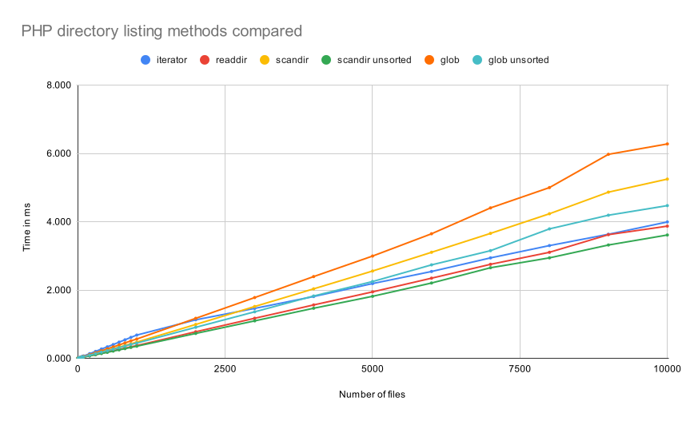

I benchmarked the common ways to list files in a local directory in PHP.

The methods I tested were `scandir`, `readdir`, `glob`, and `DirectoryIterator`.

As expected, runtime grows linearly with the number of directory entries.

Sorting accounts for a noticeable share of that runtime. `scandir("", SCANDIR_SORT_NONE)` and `glob("*", GLOB_NOSORT")` are both at least 10-30% faster than their sorted versions, which are the default.

`scandir("", SCANDIR_SORT_NONE)` is consistently the fastest option, with `readdir` usually coming in second.

`DirectoryIterator` is the slowest option for directories with fewer than 2000 files. Its relative performance improves as the directory grows, until it is about as fast as `readdir` and `scandir` for directories with 10000 files.

Below are the raw benchmark results and the code I used. Times are in `ms` and calculated as the average across 100 iterations.



### Benchmark results

| files | DirectoryIterator | readdir | scandir | scandir unsorted | glob | glob unsorted |
| --- | --- | --- | --- | --- | --- | --- |
| 1 | 0.008 | 0.006 | 0.006 | 0.006 | 0.006 | 0.005 |
| 10 | 0.013 | 0.009 | 0.009 | 0.008 | 0.010 | 0.009 |
| 100 | 0.071 | 0.041 | 0.046 | 0.039 | 0.056 | 0.049 |
| 1000 | 0.683 | 0.376 | 0.477 | 0.357 | 0.568 | 0.449 |
| 10000 | 3.994 | 3.872 | 5.248 | 3.612 | 6.277 | 4.472 |

### Benchmark code

```php
<?php
namespace D;
class DirectoryReader
{
    public function __construct(
        protected string $directory,
    ) {
    }
    public function iterator($flags = 0)
    {
        $results = array();
        foreach (new \DirectoryIterator($this->directory) as $fileInfo) {
            $results[] = $fileInfo;
        }
        return $results;
    }
    public function readdir($flags = 0)
    {
        $results = array();
        if ($handle = opendir($this->directory)) {
            while (false !== ($filename = readdir($handle))) {
                $results[] = $filename;
            }
            closedir($handle);
        }
        return $results;
    }
    public function scandir($flags = 0)
    {
        return scandir($this->directory, $flags);
    }
    public function glob($flags = 0)
    {
        return glob($this->directory . '/*', $flags);
    }
}
if (empty($argv[1])) {
    echo "Usage: php " . basename(__FILE__) . " <directory>\n";
    exit(1);
}
$directory = $argv[1];
if (is_dir($directory)) {
    echo "Directory exists already\n";
    exit(1);
}
mkdir($directory, 0755);
$reader = new DirectoryReader($directory);
$n_iterations = 100;
$step_size = 10;
$tests = [
    ['iterator', 0],
    ['readdir', 0],
    ['scandir', 0],
    ['scandir', SCANDIR_SORT_NONE],
    ['glob', 0],
    ['glob', GLOB_NOSORT],
];
echo "files\t" . join("\t", array_map(function ($t) {
    $name = $t[0];
    if ($t[1]) {
        $name .= ' unsorted';
    }
    return $name;
}, $tests)) . "\n";
for ($n = 1; $n <= 10000; $n *= 10) {
    for ($f = (int) ($n / 10); $f <= $n; $f++) {
        touch("{$directory}/{$f}.txt");
    }
    $line = "{$n}\t";
    foreach ($tests as [$method, $flags]) {
        $start = microtime(true);
        for ($i = 0; $i < $n_iterations; $i++) {
            $reader->{$method}($flags);
        }
        $end = microtime(true);
        $time_per_it = sprintf('%.3f', ($end - $start) / $n_iterations * 1000);
        $line .= "$time_per_it\t";
    }
    $line .= "\n";
    echo $line;
}
```
